# Advanced Architecting on AWSのデモの構成図とハンズオン

Advanced Architecting on AWSの授業で見せたデモの構成図と、自分のアカウントで試せるハンズオンのリポジトリをまとめました。授業の後の見返しに使ってください。

## 授業で見せたデモ

### モジュール1・Multi-AZ WordPress(CloudFormation)

CloudFormationで、Application Load Balancer、Auto Scaling、RDS for MySQLのMulti-AZ構成を作りました。利用者からの通信の経路と、WordPressのデータをEFSとRDSのどこに置くかを図で確かめます。

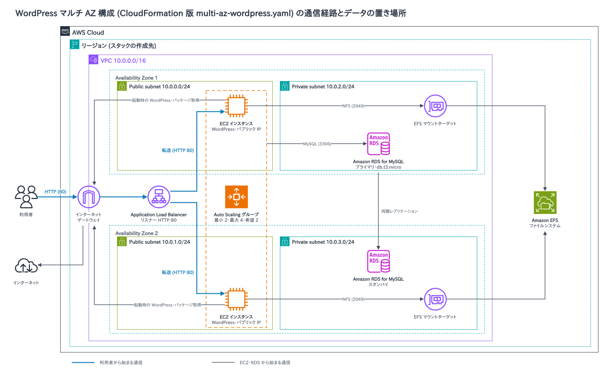

参考: [Configuring and managing a Multi-AZ deployment for Amazon RDS](https://docs.aws.amazon.com/AmazonRDS/latest/UserGuide/Concepts.MultiAZ.html)、[What is Amazon EC2 Auto Scaling?](https://docs.aws.amazon.com/autoscaling/ec2/userguide/what-is-amazon-ec2-auto-scaling.html)

### モジュール2・IAM Identity CenterとSCPによるリージョン・インスタンスタイプの制限

IAM Identity Centerからサンドボックスのアカウントを開き、組織のSCPで操作が拒否されることを `--dry-run` で確かめました。m5.4xlargeの起動と、ソウルリージョンでの `describe-vpcs` は拒否され、t3.microの起動は許可されます。

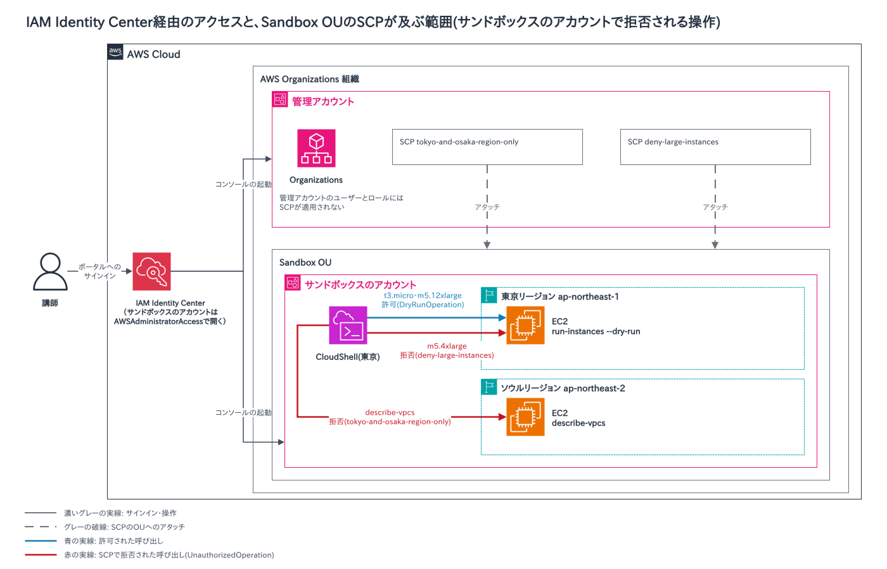

参考: [Service control policies (SCPs)](https://docs.aws.amazon.com/organizations/latest/userguide/orgs_manage_policies_scps.html)、[What is IAM Identity Center?](https://docs.aws.amazon.com/singlesignon/latest/userguide/what-is.html)

### モジュール2・スイッチロール

IAM Identity Centerのセッションから、別のアカウントのロールに切り替えました。ロールを引き受けるには、切り替え元の許可と、切り替え先の信頼ポリシーの2つが必要です。

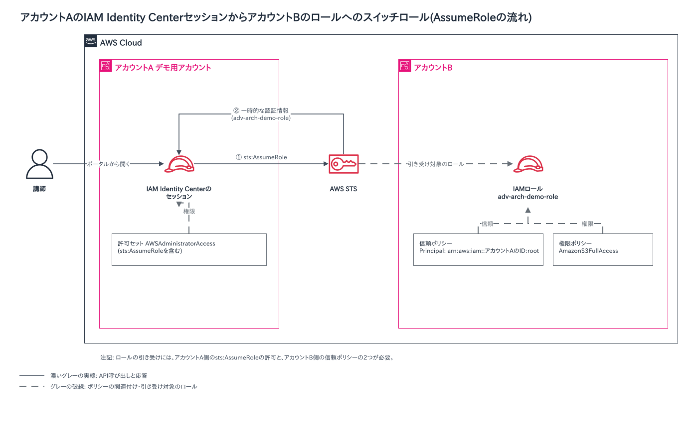

参考: [Switch from a user to an IAM role (console)](https://docs.aws.amazon.com/IAM/latest/UserGuide/id_roles_use_switch-role-console.html)

### モジュール3・Client VPN

開発サーバーからOpenVPNでClient VPNエンドポイントに接続し、VPCの中にあるEC2のプライベートIPへ、pingとcurlで届くことを確かめました。接続の前後で `ip route` を比べると、split-tunnelでVPC宛ての経路だけが増えます。

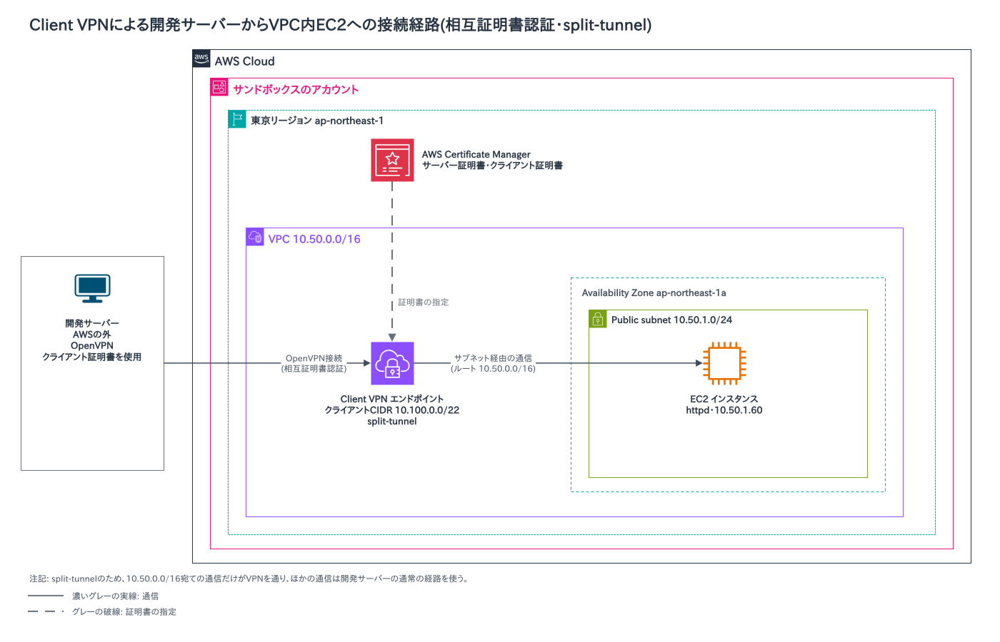

参考: [What is AWS Client VPN?](https://docs.aws.amazon.com/vpn/latest/clientvpn-admin/what-is.html)、[Split-tunnel on AWS Client VPN endpoints](https://docs.aws.amazon.com/vpn/latest/clientvpn-admin/split-tunnel-vpn.html)

### モジュール4・Storage Gateway File Gateway

オンプレミスのVMで動くStorage Gatewayに、SMBとNFSの共有を作りました。クライアントから書き込んだファイルが、数秒でS3バケットに入ります。キャッシュはオンプレミスのディスクに置き、ファイルの実体はS3に保存します。

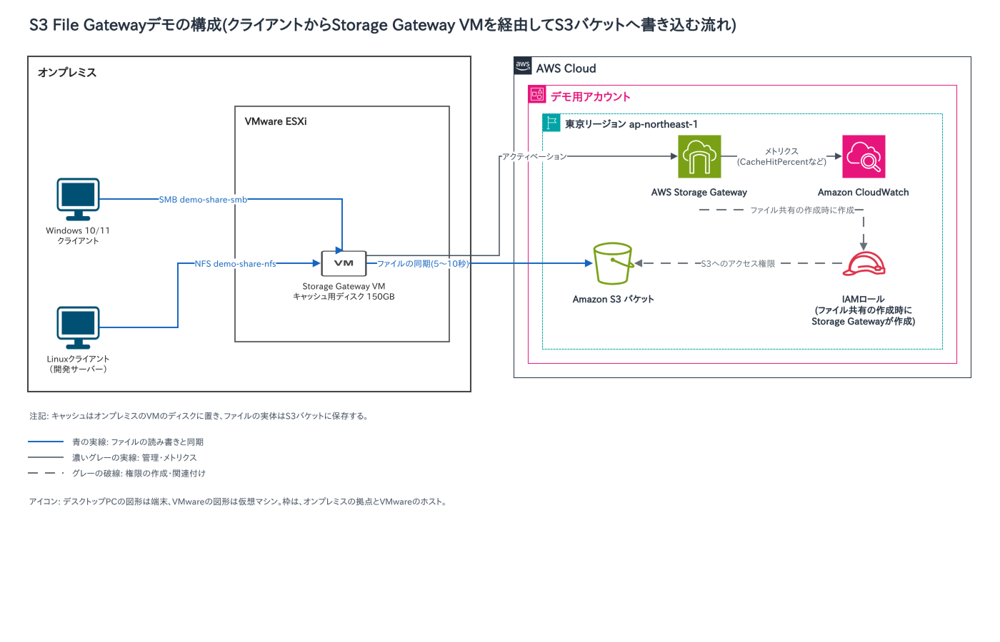

参考: [What is Amazon S3 File Gateway](https://docs.aws.amazon.com/filegateway/latest/files3/what-is-file-s3.html)

### モジュール5・Transit Gateway

Transit Gatewayで、Dev・Prod・Sharedの3つのVPCを接続しました。続けて、Transit Gatewayのルートテーブルを分けて、DevとProdの間の通信を止めます。

設定前は、Dev・Prod・Sharedが相互に通信できます。

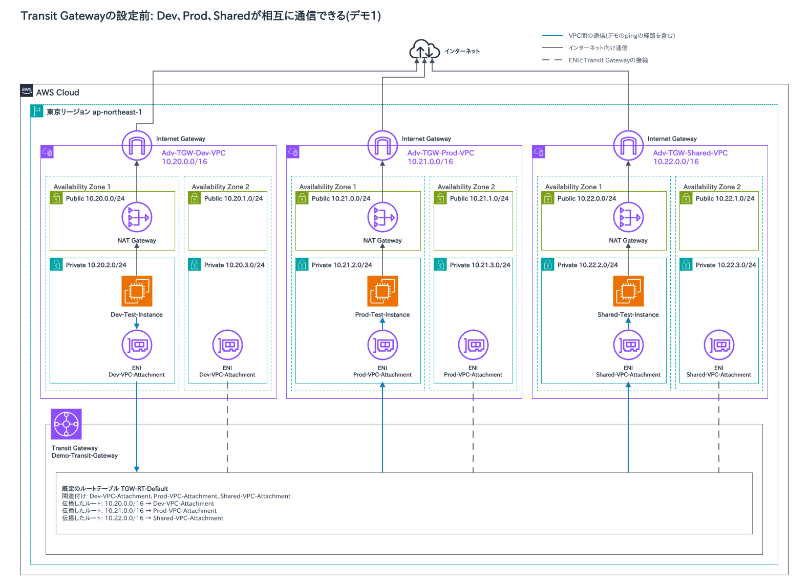

設定後は、DevとProdは通信できず、DevとProdはそれぞれSharedと通信できます。

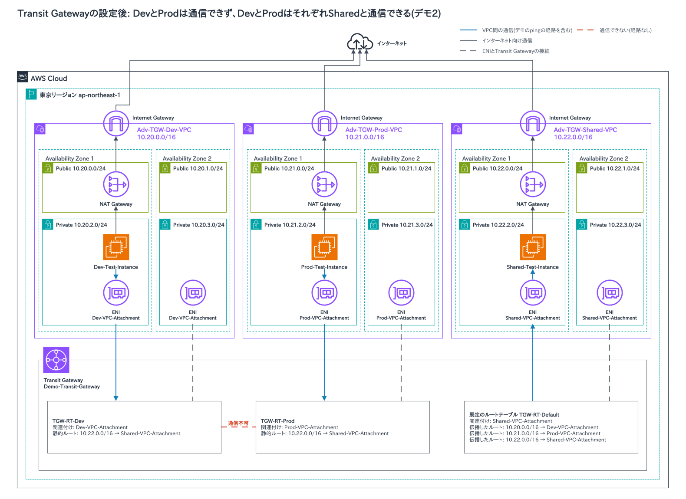

参考: [What is AWS Transit Gateway for Amazon VPC?](https://docs.aws.amazon.com/vpc/latest/tgw/what-is-transit-gateway.html)、[Transit gateway route tables in AWS Transit Gateway](https://docs.aws.amazon.com/vpc/latest/tgw/tgw-route-tables.html)

### モジュール6・Dockerの基本操作とカスタムイメージ

`docker pull` と `docker container run` で、httpdとnginxのコンテナを起動しました。続けて、Dockerfileから `docker image build` でカスタムイメージを作り、ブラウザで表示します。

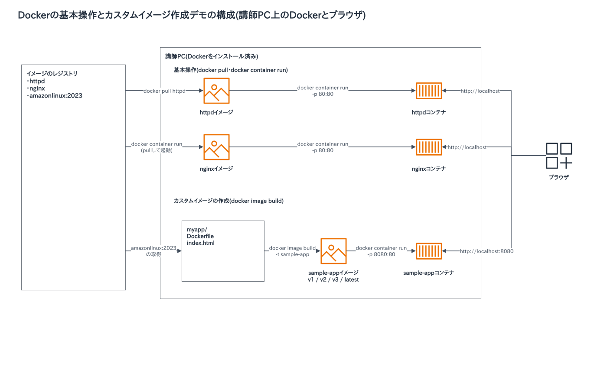

参考: [Creating a container image for use on Amazon ECS](https://docs.aws.amazon.com/AmazonECS/latest/developerguide/create-container-image.html)

### モジュール6・ECS/Fargateへのデプロイ

EC2でDockerイメージをビルドしてAmazon ECRに登録し、Amazon ECSのFargateで実行しました。ECSのタスク定義がECRのイメージを参照し、Fargateタスクにインターネットから届きます。

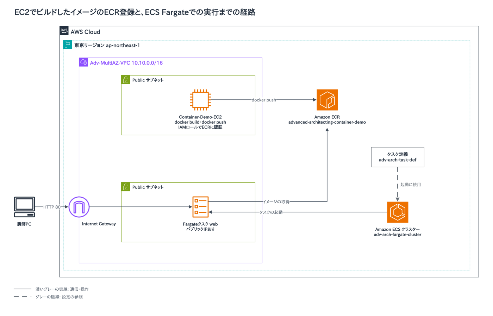

参考: [Architect for AWS Fargate for Amazon ECS](https://docs.aws.amazon.com/AmazonECS/latest/developerguide/AWS_Fargate.html)、[What is Amazon Elastic Container Registry?](https://docs.aws.amazon.com/AmazonECR/latest/userguide/what-is-ecr.html)

### モジュール7・CodePipeline(ECS Fargate版)

GitHubへのpushをきっかけに、CodePipelineがCodeBuildでイメージを作り、手動承認のあとECS Fargateへ反映する流れを見せました。承認するまで、本番の画面は変わりません。

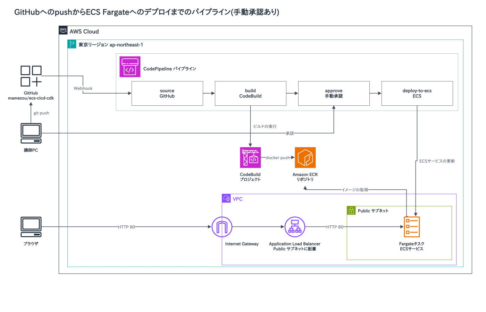

参考: [What is AWS CodePipeline?](https://docs.aws.amazon.com/codepipeline/latest/userguide/welcome.html)、[Add a manual approval action to a stage](https://docs.aws.amazon.com/codepipeline/latest/userguide/approvals.html)

### モジュール8・AWS WAFによるSQLインジェクションの保護

Application Load BalancerにAWS WAFのウェブACLを関連付け、マネージドルールのSQLiルールセットでSQLインジェクションを防ぎました。WAFは通信の途中に置くのではなく、ALBに関連付けて使います。

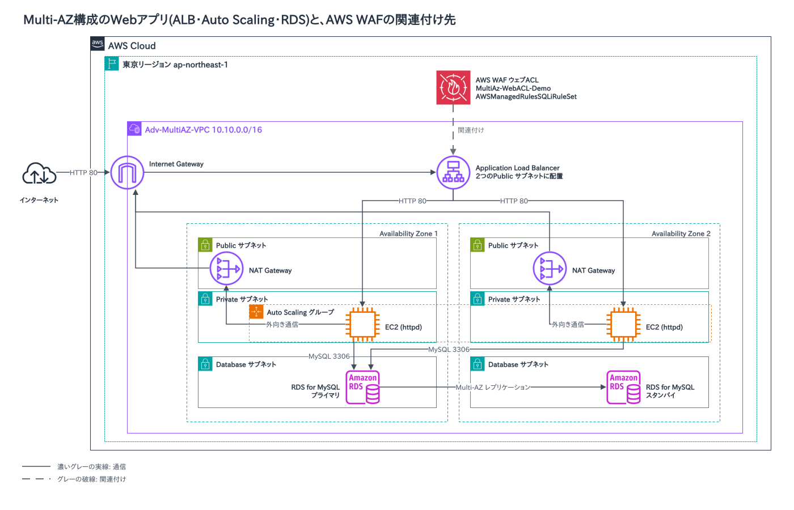

参考: [AWS WAF](https://docs.aws.amazon.com/waf/latest/developerguide/waf-chapter.html)、[Use-case specific rule groups](https://docs.aws.amazon.com/waf/latest/developerguide/aws-managed-rule-groups-use-case.html)

### モジュール9・KMSによる暗号化

KMSのエンベロープ暗号化でデータキーを作り、ファイルを暗号化・復号しました。続けて、SSE-S3とSSE-KMSのS3バケットを比べ、CloudTrailでKMSの呼び出しの記録を確かめます。SSE-KMSだけ、GenerateDataKeyとDecryptが記録されます。

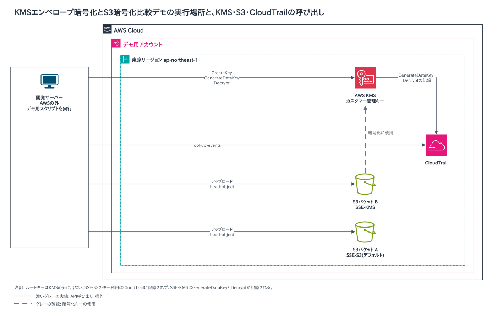

**パート1の流れ**

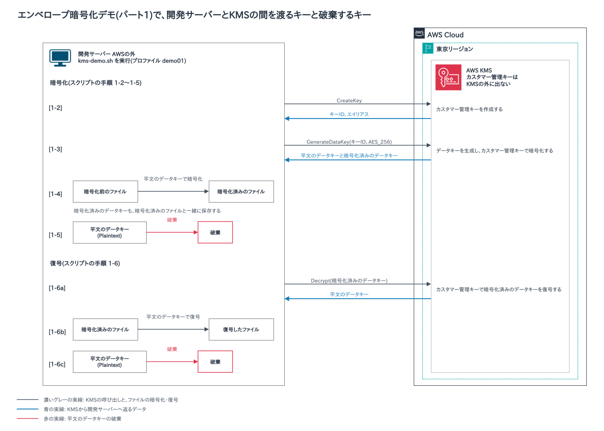

参考: [AWS KMS cryptography essentials](https://docs.aws.amazon.com/kms/latest/developerguide/kms-cryptography.html)、[Using server-side encryption with AWS KMS keys (SSE-KMS)](https://docs.aws.amazon.com/AmazonS3/latest/userguide/UsingKMSEncryption.html)

## 自分のアカウントで試せるハンズオン

自分のAWSアカウントにフォークして試せるリポジトリです。作ったリソースには料金がかかります。使い終わったら削除してください。

| モジュール | リポジトリ | 内容 | 所要時間の目安 |
|---|---|---|---|
| 1 | [scalable-website-cfn](https://github.com/mamezou/scalable-website-cfn) | CloudFormationでWordPressを作ります。Single-AZの構成から、Multi-AZとAuto Scalingの構成へ段階的に進みます。 | 10〜15分 |
| 1 | [fargate-wordpress-cdk](https://github.com/mamezou/fargate-wordpress-cdk) | CDK(TypeScript)で、Fargate、RDS、EFSによるWordPressの高可用性構成を作ります。 | 15〜20分 |
| 5 | [tgw-demo-share](https://github.com/mamezou/tgw-demo-share) | Transit Gatewayで複数のVPCを接続します。 | 10〜15分 |
| 7 | [ecs-cicd-cdk](https://github.com/mamezou/ecs-cicd-cdk) | GitHubへのpushから、CodePipeline、CodeBuild、手動承認を経て、ECS Fargateに反映するCI/CDを作ります。起動中はALBとFargateの料金がかかります。 | 15〜20分 |
| 10 | [redis-demo](https://github.com/mamezou/redis-demo) | ElastiCache for Redisのクラスターを作ります。 | 30〜40分 |
