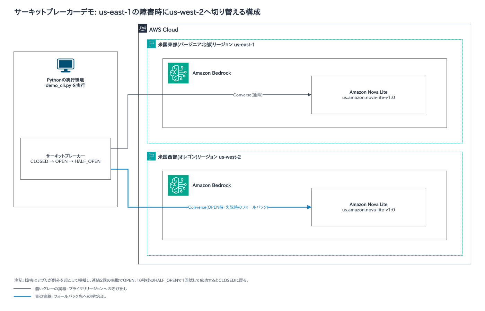
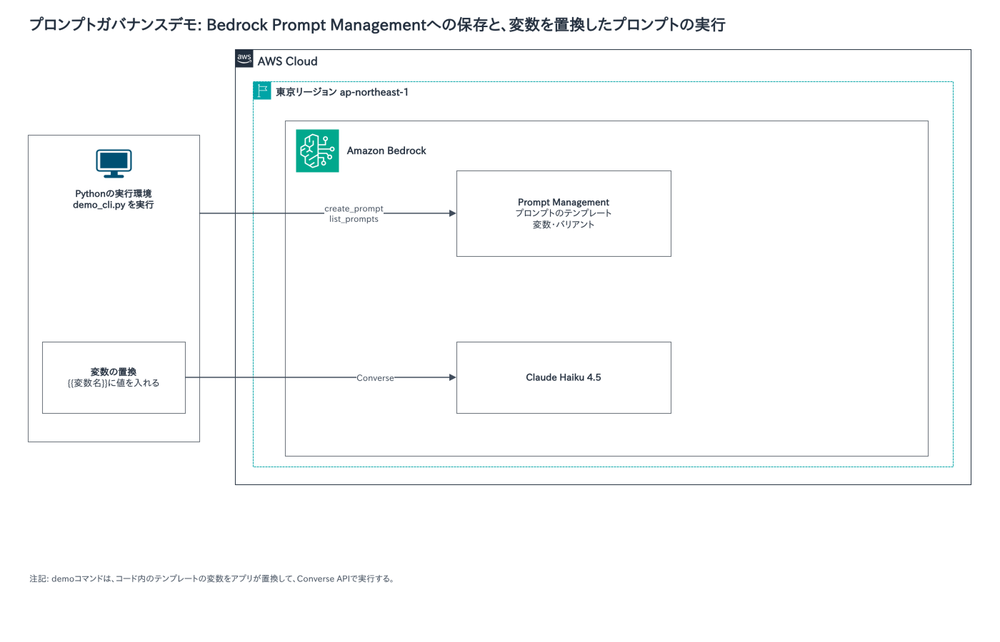
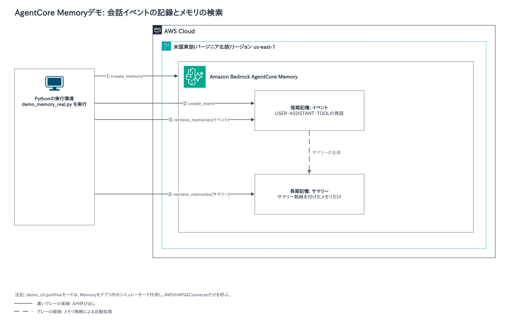
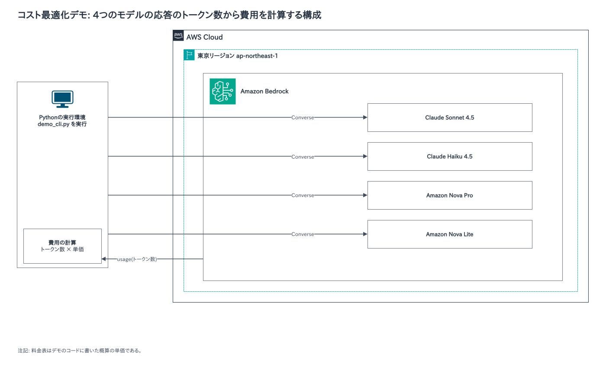
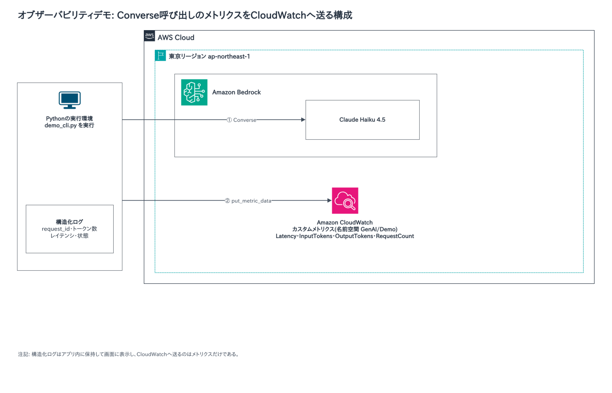

# Advanced Generative AI Development on AWSのデモの構成図とハンズオン

Advanced Generative AI Development on AWSのデモの構成図と、自分のアカウントで試せるハンズオンのリポジトリをまとめました。授業の後の見返しに使ってください。

## デモの構成図

### デモ01・サーキットブレーカー(モジュール1)

米国東部(バージニア北部)のBedrockを優先して呼び、障害が続くと米国西部(オレゴン)へ切り替えます。連続2回の失敗でサーキットがOPENになり、10秒後のHALF_OPENで1回試して成功するとCLOSEDに戻ります。障害は、アプリが例外を起こして模擬します。

### デモ04・プロンプトガバナンス(モジュール4)

Bedrock Prompt Managementにプロンプトのテンプレートを作成し、一覧で確かめます。続けて、テンプレートの変数を値に置換したプロンプトを、Converse APIで実行します。

### デモ05・AgentCore(モジュール5)

AgentCore Memoryに、メモリを作り、会話のイベントを記録し、検索します。サマリー戦略を付けたメモリでは、イベントから長期記憶のサマリーが作られます。

### デモ07・コスト最適化(モジュール7)

同じプロンプトを4つのモデルに送り、応答のトークン数から費用を計算して比べます。費用は、コードに書いた概算の単価で計算します。

### デモ08・オブザーバビリティ(モジュール8)

Converseの呼び出しごとに、リクエストID、トークン数、レイテンシを構造化ログに残し、CloudWatchへカスタムメトリクスを送ります。構造化ログはアプリ内に保持して画面に表示し、CloudWatchへ送るのはメトリクスだけです。

## 自分のアカウントで試せるハンズオン

自分のAWSアカウントで試せるリポジトリです。作ったリソースには料金がかかります。使い終わったら削除してください。

| モジュール | リポジトリ | 内容 |
|---|---|---|
| 5 | [agentcore-cdk-steps](https://github.com/mamezou/agentcore-cdk-steps) | AgentCore RuntimeとReactのフロントエンドを、CDKで段階的にデプロイします。ブランチごとに、基本構成からTool Use、Code Interpreter、Memory、Browserへ進みます。 |
