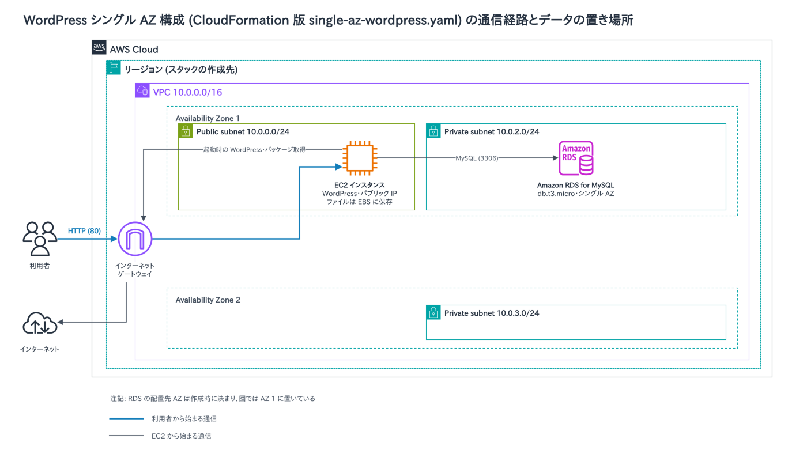
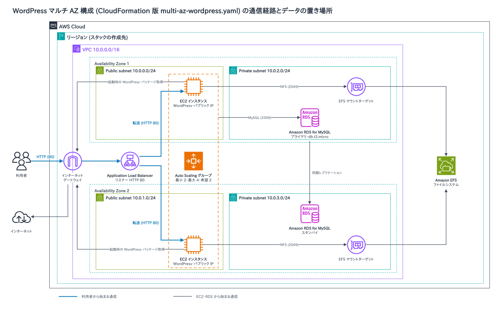
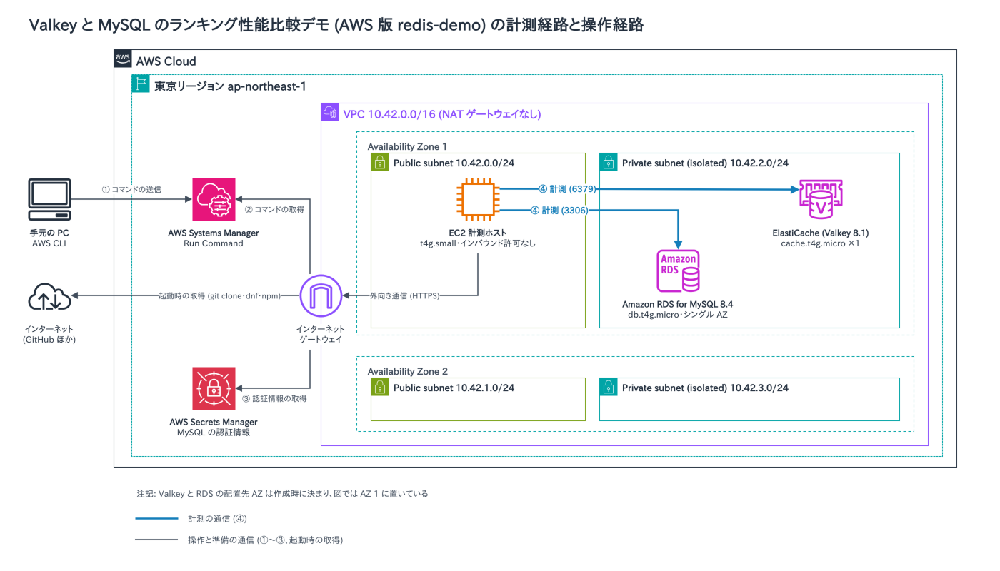

# Architecting on AWSのデモの構成図とハンズオン

Architecting on AWSの授業で見せたWordPressのデモの構成図と、自分のアカウントで試せるハンズオンをまとめました。授業の後の見返しに使ってください。

## 自分のアカウントで試せるハンズオン

自分のAWSアカウントで試せるハンズオンです。手順は各フォルダのREADMEにあります。作ったリソースには料金がかかります。使い終わったら削除してください。

| モジュール | ハンズオン | 内容 | 所要時間の目安 |
|---|---|---|---|
| 8 | [scalable-website-cfn](scalable-website-cfn/) | CloudFormationでWordPressを作ります。Single-AZの構成から、Multi-AZとAuto Scalingの構成へ段階的に進みます。 | 10〜15分 |
| 8 | [fargate-wordpress-cdk](fargate-wordpress-cdk/) | CDK(TypeScript)で、Fargate、RDS、EFSによるWordPressの構成を作ります。 | 15〜20分 |
| 6 | [redis-demo](redis-demo/) | ElastiCache(Valkey)とRDS for MySQLに同じランキングのデータを入れ、書き込みと順位の取得の速度を比べます。 | 30〜40分 |

## 構成図

### Single-AZのWordPress(scalable-website-cfn)

WordPressを入れたEC2を1台作ります。サブネットは2つのAZに作ります。

### Multi-AZのWordPress(scalable-website-cfn)

WordPressのファイルをEFSに置き、EC2をAuto Scalingグループで2つのAZに配置します。RDS for MySQLはMulti-AZ配置です。

### WordPress on Fargate(fargate-wordpress-cdk)

Application Load Balancer、Fargateのタスク、RDS for MySQL 8.4、EFSでWordPressを動かします。

### ValkeyとMySQLのランキング性能比較(redis-demo)

CDKで、計測用のEC2、ElastiCache(Valkey)、RDS for MySQLを作ります。手元のPCからSystems ManagerのRun Commandで計測のコマンドを送り、EC2からValkeyとMySQLへの計測の通信を図で確かめます。

