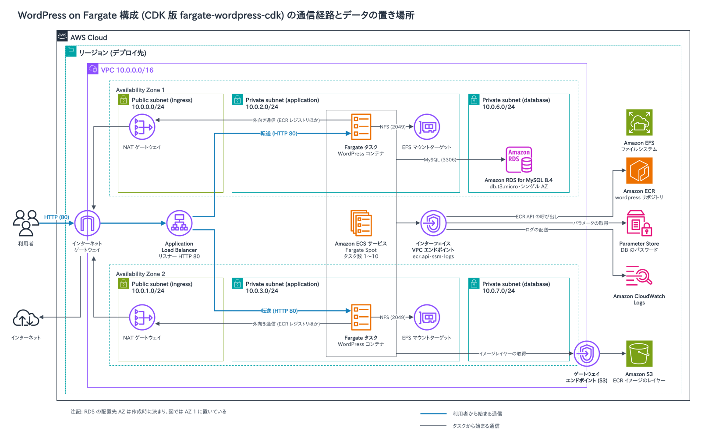

# Architecting on AWSのデモの構成図とハンズオン

Architecting on AWSの授業で見せたWordPressのデモの構成図と、自分のアカウントで試せるハンズオンのリポジトリをまとめました。授業の後の見返しに使ってください。

## 自分のアカウントで試せるハンズオン

自分のAWSアカウントにフォークして試せるリポジトリです。作ったリソースには料金がかかります。使い終わったら削除してください。

| リポジトリ | 内容 | 所要時間の目安 |
|---|---|---|
| [scalable-website-cfn](https://github.com/mamezou/scalable-website-cfn) | CloudFormationでWordPressを作ります。Single-AZの構成から、Multi-AZとAuto Scalingの構成へ段階的に進みます。 | 10〜15分 |
| [fargate-wordpress-cdk](https://github.com/mamezou/fargate-wordpress-cdk) | CDK(TypeScript)で、Fargate、RDS、EFSによるWordPressの構成を作ります。 | 15〜20分 |

## 構成図

### Single-AZのWordPress(scalable-website-cfn)

WordPressを入れたEC2を1台作ります。サブネットは2つのAZに作ります。

### Multi-AZのWordPress(scalable-website-cfn)

WordPressのファイルをEFSに置き、EC2をAuto Scalingグループで2つのAZに配置します。RDS for MySQLはMulti-AZ配置です。

### WordPress on Fargate(fargate-wordpress-cdk)

Application Load Balancer、Fargateのタスク、RDS for MySQL 8.4、EFSでWordPressを動かします。

