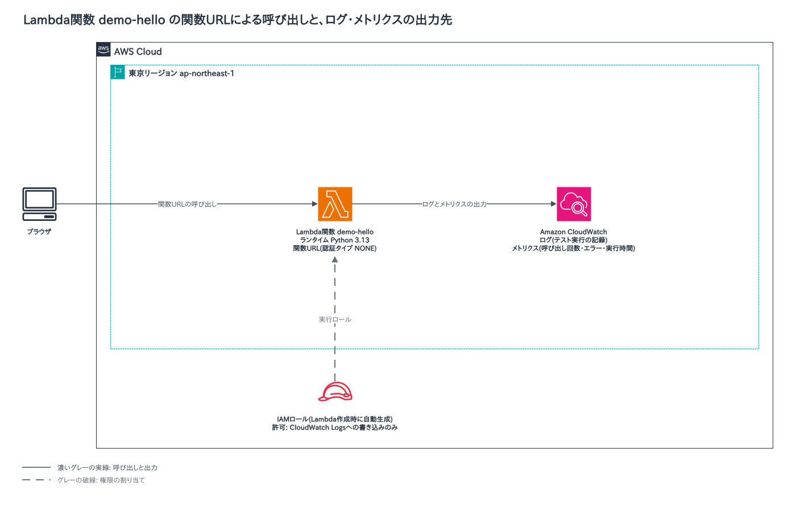
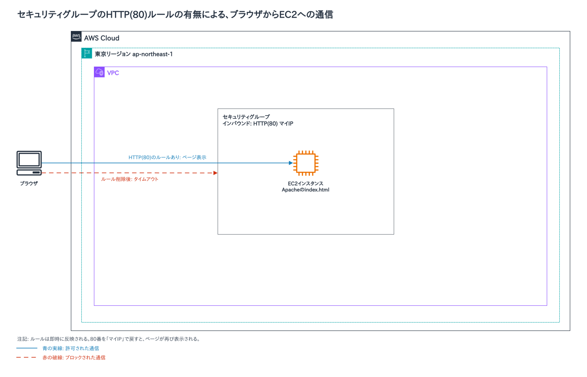
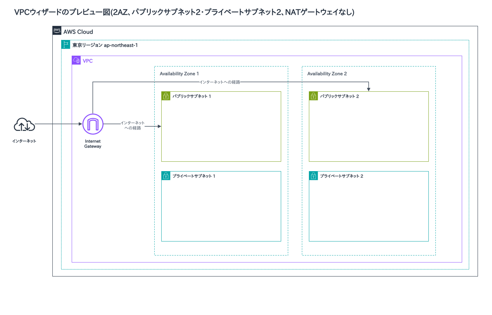
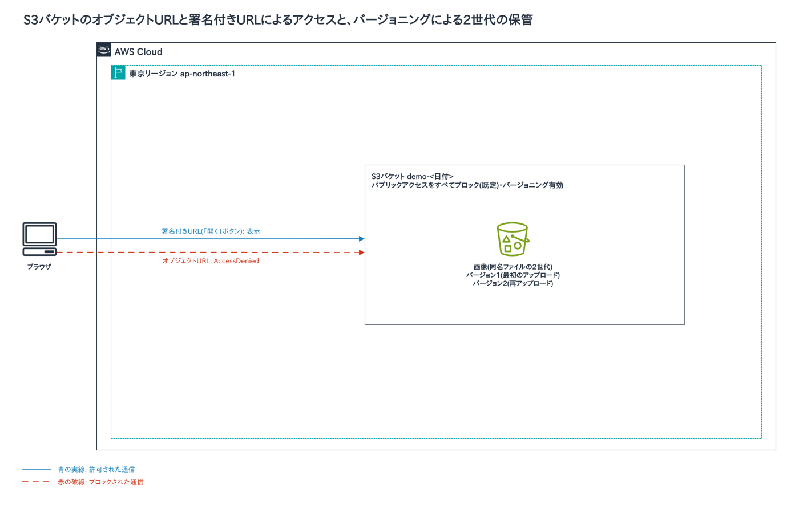
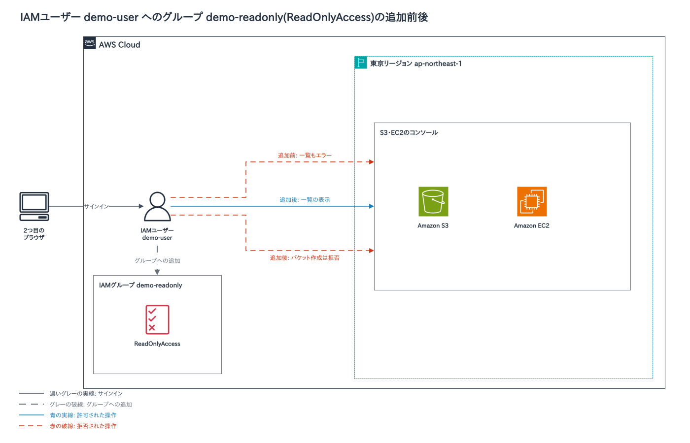
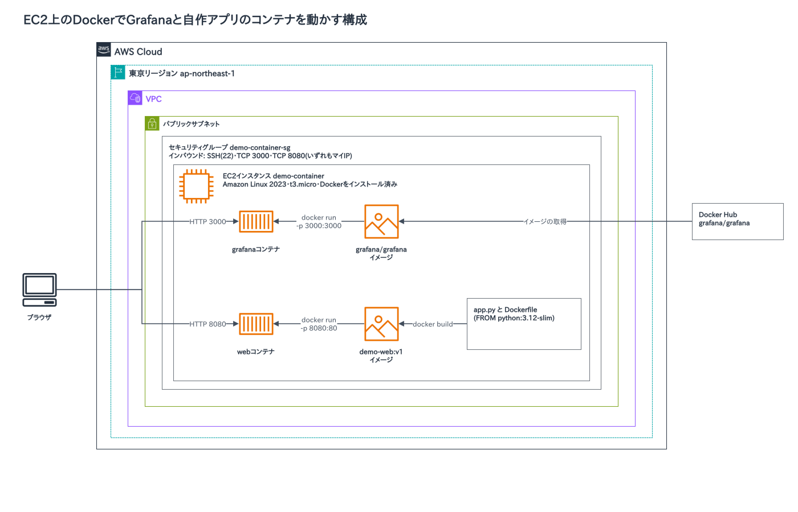
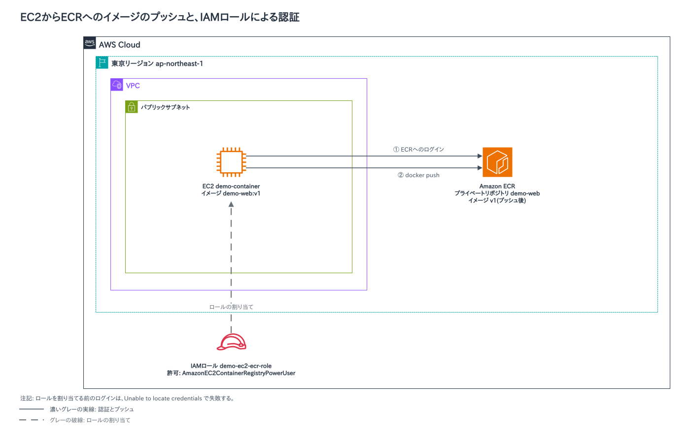
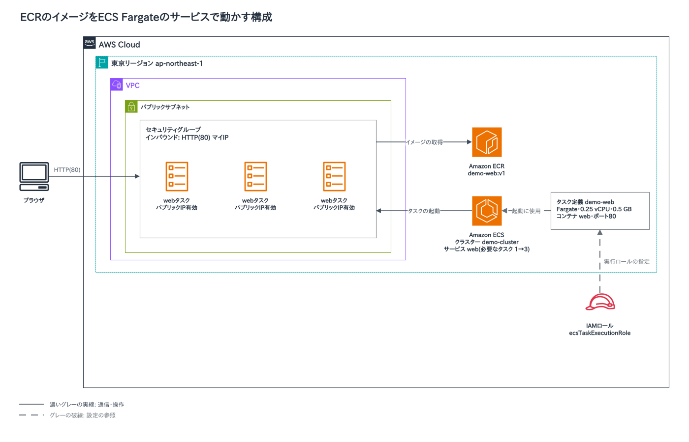

# AWS初級コース(Cloud Practitioner Essentials・Technical Essentials)のデモの構成図

AWS初級コースのデモのうち、構成を図にできるものをまとめました。授業の後の見返しに使ってください。マネジメントコンソールの画面操作だけのデモは、図にしていません。

## コンピューティング

### Lambda関数の作成と関数URL

Lambda関数を作り、テスト実行しました。続けて関数URLを付け、ブラウザから呼び出します。実行のログとメトリクスはCloudWatchに出力され、ログを書く権限はLambdaの実行ロールが持っています。

## ネットワーク

### セキュリティグループでWebを止める

EC2のセキュリティグループから、HTTP(80)のインバウンドルールを削除しました。ブラウザからのアクセスはタイムアウトします。80番を「マイIP」で戻すと、ページが再び表示されます。

### VPCウィザードのプレビュー図

VPCの作成画面で「VPCなど」を選び、2つのAvailability Zone、パブリックサブネット2つ、プライベートサブネット2つ、NATゲートウェイなしの構成を表示しました。パブリックサブネットは、インターネットゲートウェイへの経路があるサブネットです。

## ストレージ

### S3のアクセスとバージョニング

S3にバケットを作り、画像をアップロードしました。オブジェクトURLではAccessDeniedになり、「開く」ボタンの署名付きURLでは表示されます。バージョニングを有効にして同名のファイルを再アップロードすると、2世代が残ります。

## セキュリティ

### IAMユーザーとグループ

権限を付けていないIAMユーザーでは、S3やEC2の画面がエラーになります。ReadOnlyAccessを付けたグループにユーザーを追加すると、一覧は見えますが、バケットの作成は拒否されます。

## コンテナ

EC2でDockerを動かすところから、ECRへのプッシュ、ECSのFargateでの実行までを、順に見せました。

### EC2上のDockerでGrafanaと自作アプリを動かす

EC2にDockerを入れ、Docker HubのGrafanaイメージを起動しました。続けて、Dockerfileから自作アプリのイメージを作り、ポート8080で起動します。

### EC2からECRへのプッシュ

作ったイメージをECRにプッシュしました。IAMロールを付ける前はログインに失敗し、ロールを付けると成功します。

### ECSのFargateで動かす

ECRのイメージを、ECSのFargateのサービスで動かしました。必要なタスクの数を3にすると、コンテナIDの違うタスクが3つ動きます。

