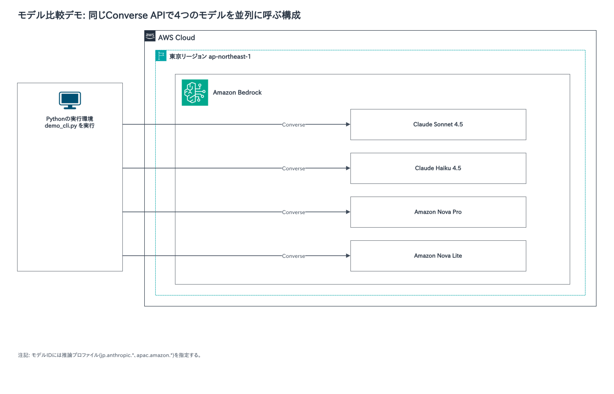
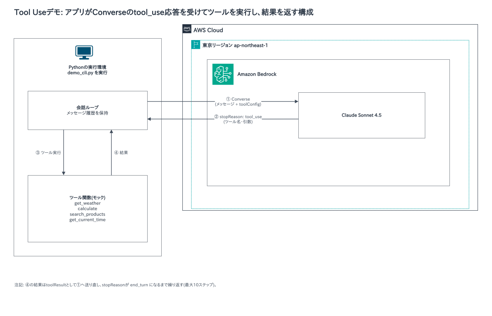
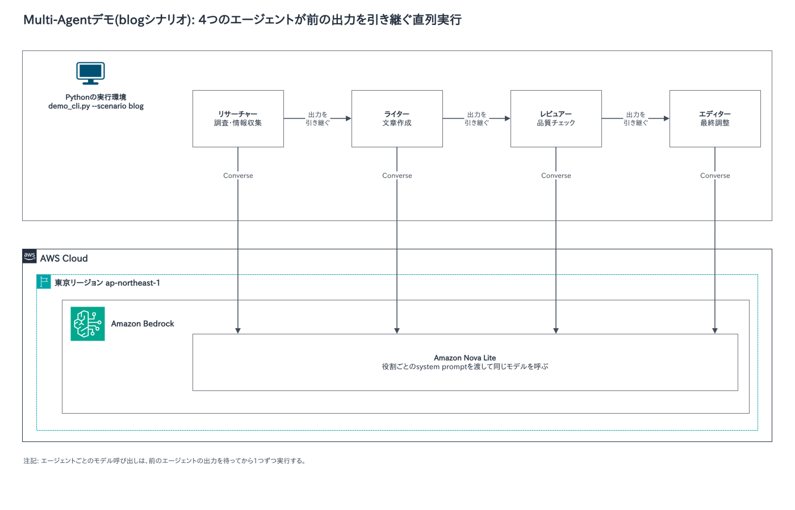

# Developing Generative AI Applications on AWSのデモの構成図とハンズオン

Developing Generative AI Applications on AWSのデモの構成図と、自分のアカウントで試せるハンズオンのリポジトリをまとめました。授業の後の見返しに使ってください。

## デモの構成図

### デモ01・モデル比較(モジュール2)

同じプロンプトを、Claude Sonnet 4.5、Claude Haiku 4.5、Amazon Nova Pro、Amazon Nova Liteの4つのモデルへ、Converse APIで並列に送ります。モデルを替えても呼び出し方は同じで、変わるのはモデルIDだけです。

### デモ05・Tool Use(モジュール9)

モデルがツールを選び、アプリがそのツールを実行して結果をモデルへ返すループです。応答のstopReasonが`tool_use`の間はツールの実行を繰り返し、`end_turn`になると最終回答が返ります。

### デモ06・Agent動作の可視化(モジュール10)

旅行プランナーのエージェントについて、モデルの判断とツールの呼び出しをステップごとに表示します。構成はデモ05と同じで、Converse APIとアプリ内のツールを往復します。図は[デモ05の構成図](diagrams/d05-tool-use.png)を見てください。

### デモ07・Multi-Agent(モジュール10以降)

リサーチャー、ライター、レビュアー、エディターの4つのエージェントを順に動かします。各エージェントは前のエージェントの出力を受け取り、役割ごとのsystem promptを付けて同じモデルを呼びます。

### 構成図がないデモ

デモ02(プロンプト技術の比較)は、デモ01と同じConverse APIの呼び出しで、プロンプトだけを替えます。デモ03(チャンキング比較)は、手元のPythonだけで動き、AWSを呼びません。

## 自分のアカウントで試せるハンズオン

自分のAWSアカウントで試せるリポジトリです。作ったリソースには料金がかかります。使い終わったら削除してください。

| モジュール | リポジトリ | 内容 |
|---|---|---|
| 9・10 | [agentcore-cdk-steps](https://github.com/mamezou/agentcore-cdk-steps) | AgentCore RuntimeとReactのフロントエンドを、CDKで段階的にデプロイします。ブランチごとに、基本構成からTool Use、Code Interpreter、Memory、Browserへ進みます。 |
