# AZ-104のデモの構成図

AZ-104の授業で見せたデモのうち、構成を図にできるものの構成図をまとめました。授業の後の見返しに使ってください。図は draw.ioの元データ(.drawio)とPNGを `diagrams/` に置いています。

## 授業で見せたデモ

### Blobコンテナーと共有アクセス署名(SAS)

ストレージアカウントにプライベートのBlobコンテナーを作り、ファイルをアップロードしました。匿名ではアクセスできないことと、SAS URLでアクセスできることを、権限・開始時間と有効期限・許可するプロトコルの設定とあわせて確かめます。

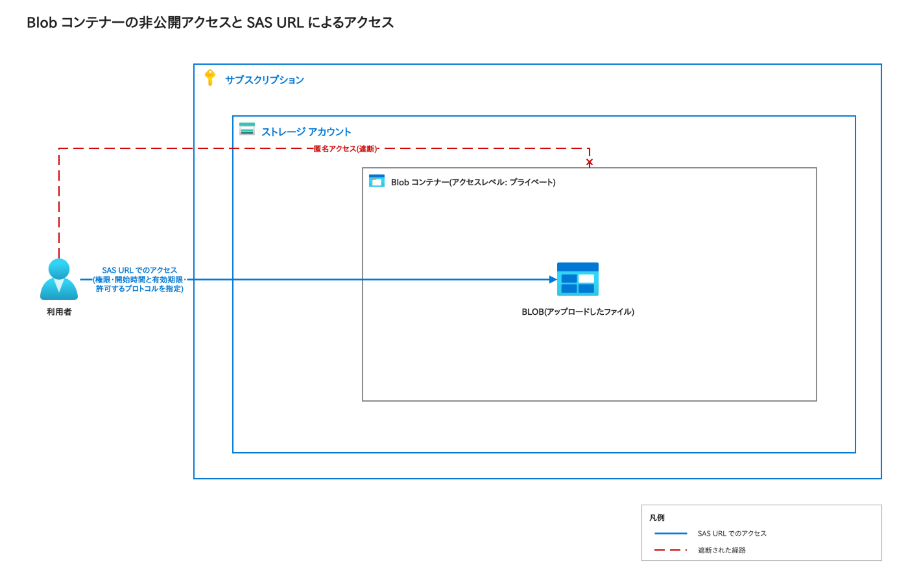

### Azureファイル共有とスナップショット

ストレージアカウントにファイル共有を作り、ファイルのアップロードとディレクトリの追加をしました。スナップショットを作成し、ファイルを削除してから、スナップショットで復元できることを確かめます。

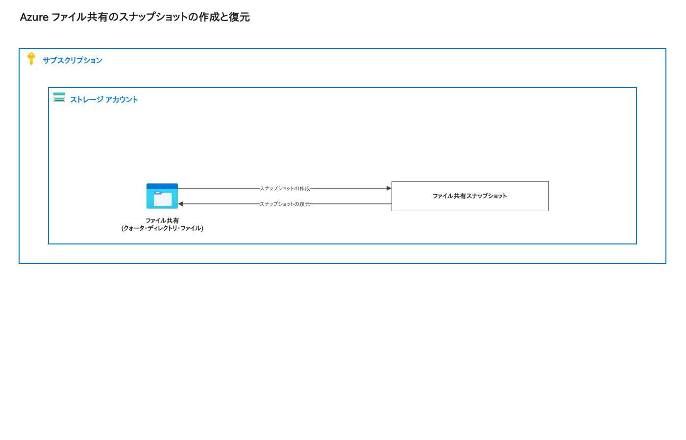

### 仮想マシンへの接続(RDP・SSHとBastion)

仮想マシンを作成し、RDP(Windows)またはSSH(Linux)での接続と、Azure Bastionでの接続を比べました。RDPやSSHよりBastionが推奨される理由を確認しました。図で2つの経路を見比べられます。

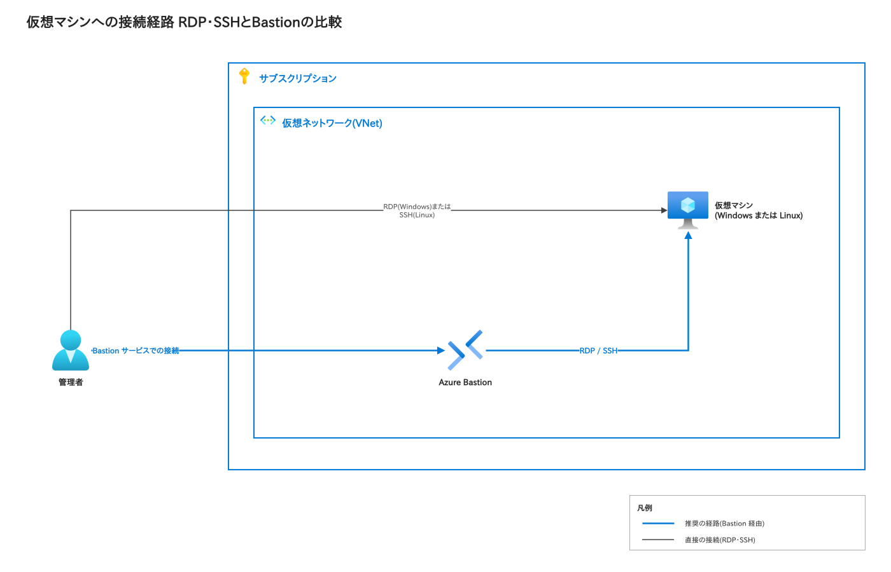

参考: [Azure Bastionのホストを作成して接続する](https://learn.microsoft.com/azure/bastion/tutorial-create-host-portal#connect)

### 仮想マシンスケールセットのスケーリング

仮想マシンスケールセットを作成し、均一とフレキシブルのオーケストレーションモードの違いを確かめました。スケーリングのタブで、手動スケールとスケールインポリシーを見たあと、CPUしきい値(%)を使うカスタムのスケーリングポリシーに変えました。

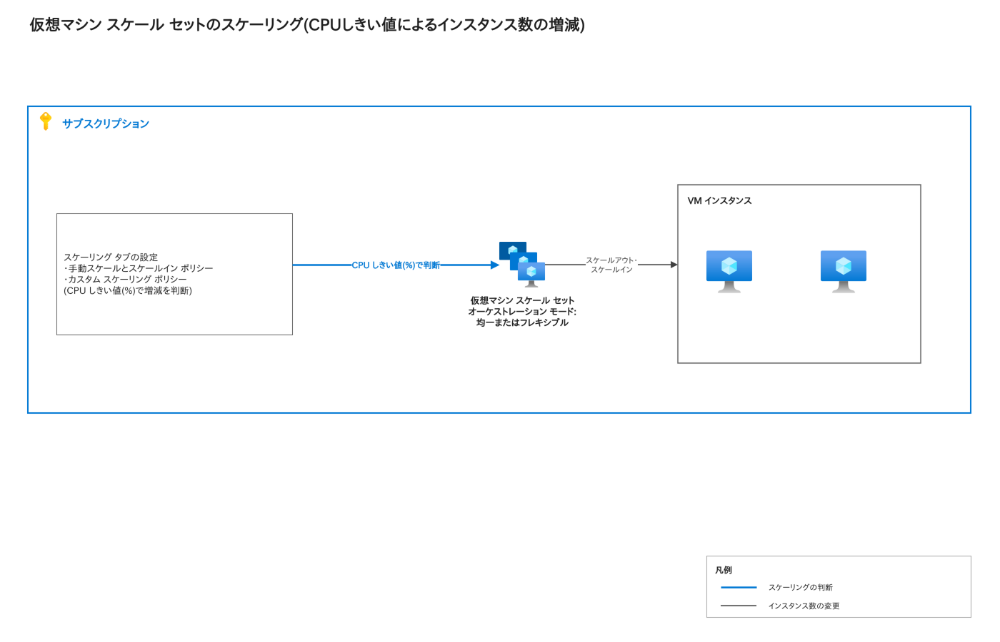

参考: [Azureポータルでスケールセット内に仮想マシンを作成する](https://learn.microsoft.com/azure/virtual-machine-scale-sets/flexible-virtual-machine-scale-sets-portal)

### App ServiceプランとWebアプリ

LinuxのApp Serviceプランで、無料のF1サービスプランのWebアプリを作成しました。プランのスケールアップとスケールアウトの画面で、手動とルールベースの違いを見て、WebアプリのURLからプレースホルダーのページが開くことを確かめます。

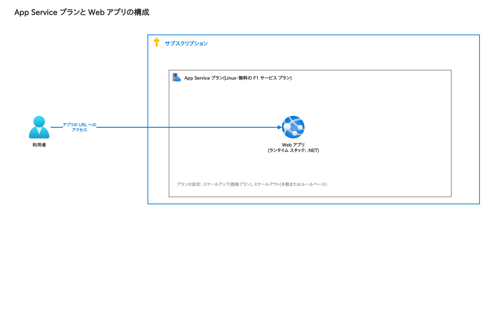

参考: [App Serviceプランの管理](https://learn.microsoft.com/azure/app-service/app-service-plan-manage)、[App Serviceでアプリをスケールアップする](https://learn.microsoft.com/azure/app-service/manage-scale-up)

### Azure Container Instances

Microsoftが公開しているサンプルイメージ(aci-helloworld)から、コンテナーインスタンスを作成しました。DNS名ラベルを指定し、FQDNにアクセスして、ようこそのページが表示されることを確かめます。

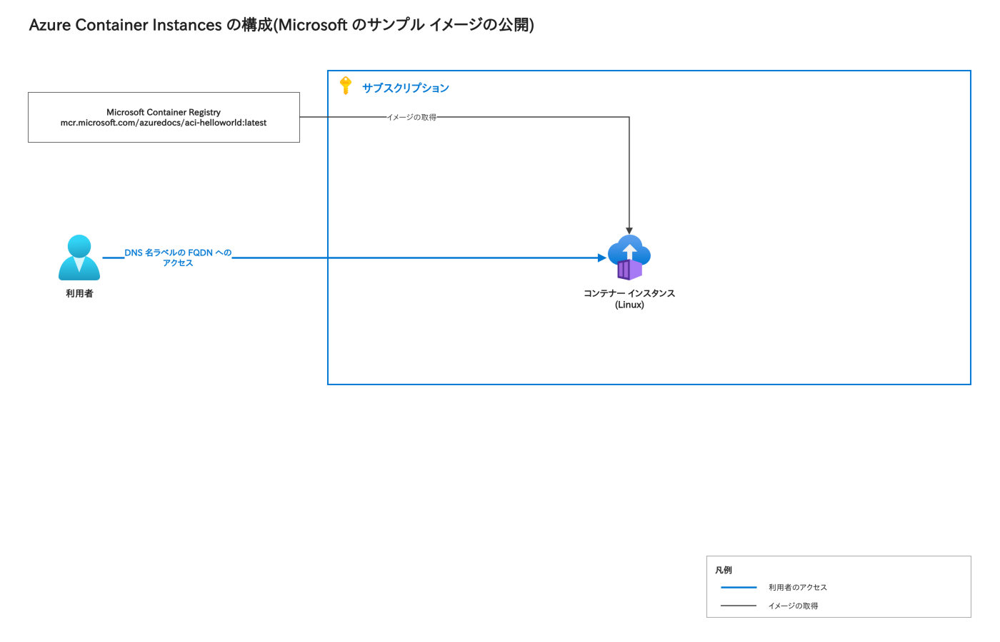

参考: [クイックスタート: コンテナーインスタンスにDockerコンテナーをデプロイする](https://learn.microsoft.com/azure/container-instances/container-instances-quickstart-portal)

### Azure Container Apps

コンテナーアプリ環境とコンテナーアプリを作成しました。アプリケーションURLにアクセスして、ようこそのメッセージが表示されることを確かめます。

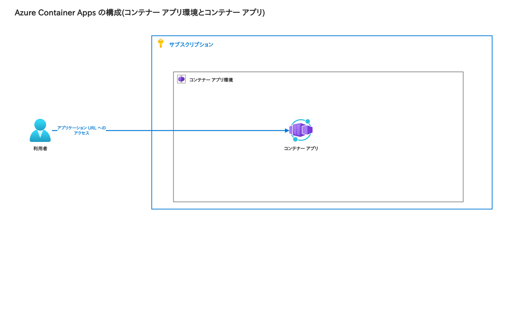

参考: [クイックスタート: Azureポータルで最初のコンテナーアプリをデプロイする](https://learn.microsoft.com/azure/container-apps/quickstart-portal)

### パブリックロードバランサー

パブリックのロードバランサーを作成しました。フロントエンドIP構成のパブリックIPアドレスと、バックエンドプールの仮想ネットワーク、負荷分散ルール(プロトコル・ポート・ヘルスプローブ・セッション永続性)の関係を確かめます。

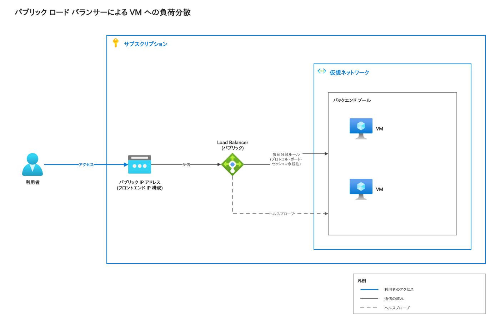

参考: [クイックスタート: パブリックロードバランサーで仮想マシンの負荷分散を行う](https://learn.microsoft.com/azure/load-balancer/quickstart-load-balancer-standard-public-portal)

### Application Gateway

新しい仮想ネットワークとサブネットに、Application Gatewayを作成しました。バックエンドプールは空のまま作成し、作成後にターゲットを追加します。ルーティングルールを、ロードバランサーの負荷分散ルールと比べます。

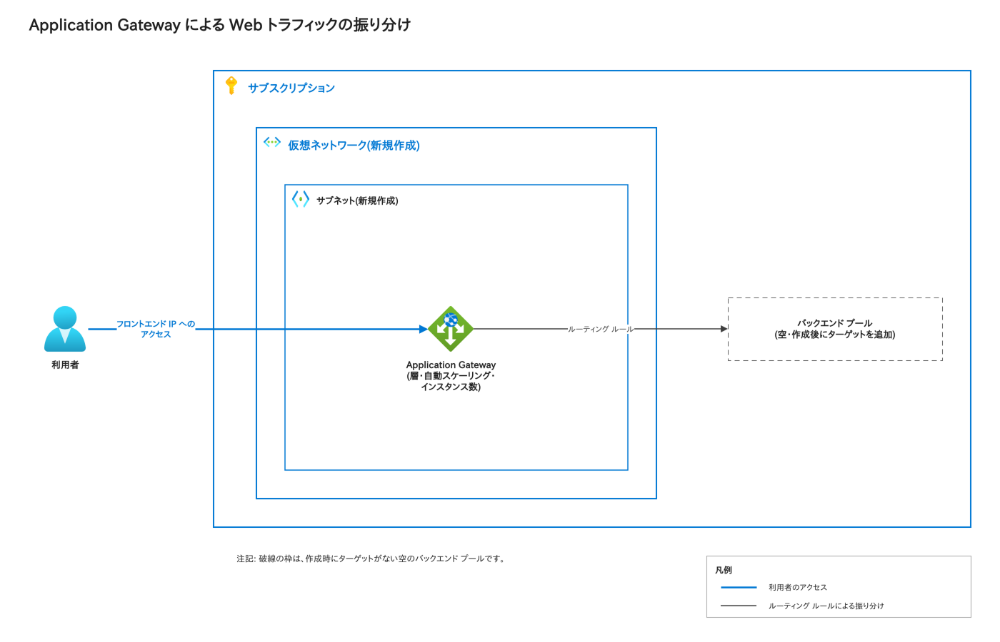

参考: [クイックスタート: Application GatewayでWebトラフィックを振り分ける](https://learn.microsoft.com/azure/application-gateway/quick-create-portal)

### ネットワークセキュリティグループ(NSG)

NSGを作成し、サブネットとネットワークインターフェイスのどちらにも関連付けられることを確かめました。既定の受信・送信の規則を見たあと、サービス(例: HTTPS)と優先度を指定した新しい規則を作ります。

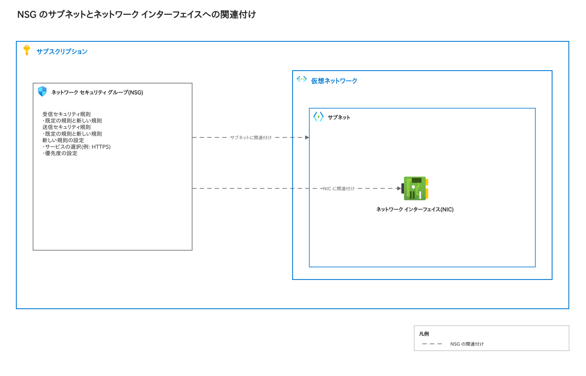

参考: [PaaSリソースへのアクセスを制限する](https://learn.microsoft.com/azure/virtual-network/tutorial-restrict-network-access-to-resources)

### Recovery Servicesコンテナーによるバックアップ

Recovery Servicesコンテナーを作成し、Azureのファイル共有と仮想マシンのバックアップを設定しました。コンテナーはファイル共有と同じリージョンに作成します。仮想マシンのDefaultPolicyは、1日1回のバックアップ、日次バックアップの30日間の保持、インスタントリカバリスナップショットの2日間の保持です。

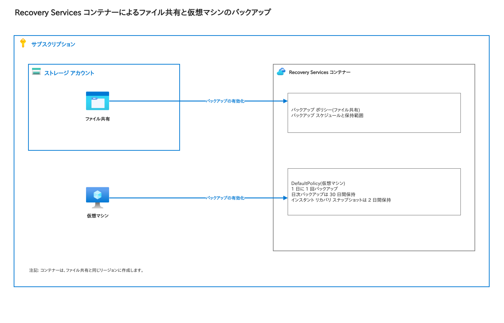

参考: [AzureポータルでAzureファイル共有をバックアップする](https://learn.microsoft.com/azure/backup/backup-afs)、[複数のAzure仮想マシンをバックアップする](https://learn.microsoft.com/azure/backup/tutorial-backup-vm-at-scale)

### Azure Monitorのアラートとログ分析

スコープ、条件、アクショングループ、重大度を指定して、アラートルールを作成しました。続けて、Log Analyticsのテーブルを見て、KQLのクエリを実行します。

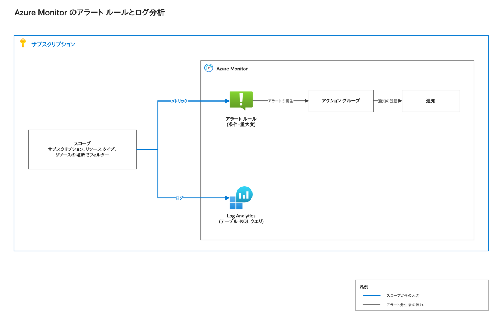

参考: [Azure Monitorでメトリックアラートを作成、表示、管理する](https://learn.microsoft.com/azure/azure-monitor/alerts/alerts-metric)
